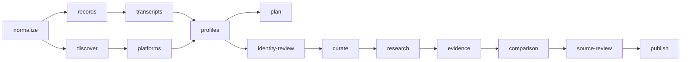

# Containerized ingestion jobs

Each ingestion job runs in a separate, one-shot Docker Compose container. Jobs
share persistent `storage/`; the host launcher orders them, shares one model-call
budget, and stops on failures. Containers do not mount the Docker socket.

## Organization

- `Dockerfile`, `.dockerignore`, `compose.yaml`: Python/PDF-extraction image and job services.
- `jobs.py`: host-side Docker orchestration and dependency planning.
- `election/jobs/`: job graph, pipeline adapters, storage locking, and audit runner.
- `election/collection/`: candidate records, platform collection, and source discovery.
- `election/analysis/`: cached model jobs, identity review, research, comparison, and source review.
- `election/pipeline.py`: curation, validation, and backend publication.
- `tests/`: offline tests, also runnable inside Docker.
- `docs/`: detailed workflows, source rules, and historical audits.
- `storage/`: persistent raw, normalized, curated, published, and run artifacts.

The original collection scripts remain thin compatibility entry points. Modules
still run without Docker using `python3 -m election` or `python3 -m election.jobs`.

## Job graph



`finder-data` and `test` are independent jobs. Source discovery and transcript
caches are shared; candidate-oriented stages accept `--district` and an exact
ballot name or candidacy ID through `--candidate`.

## Build and run

From the repository root with Docker Desktop/Engine running:

```sh
python3 ingestion/jobs.py build
python3 ingestion/jobs.py run test

# Inspect the graph without starting containers or calling a model.
python3 ingestion/jobs.py plan --through publish --district RCC --max-calls 20

# Start at comparison using existing research and source evidence.
python3 ingestion/jobs.py run --from comparison --through publish \
  --district RCC --max-calls 20

# Select cases, collect evidence, compare, review, and publish.
python3 ingestion/jobs.py run --from research --through publish \
  --district RCC --max-calls 30

# Run collection through publication for a constituency.
python3 ingestion/jobs.py run --through publish --district RCC --max-calls 50

# Resolve attribution and analyze candidates with collected voting records.
python3 ingestion/jobs.py run --from identity-review --through publish \
  --voting-only --workers 8 --max-calls 2000

# Select explicit jobs using cached prerequisite data.
python3 ingestion/jobs.py run evidence comparison source-review publish \
  --candidate "Henry Yao" --offline --max-calls 0
```

`--max-calls` defaults to zero and is shared across the entire selected workflow,
including identity, research, drafting, review, and summaries. Cached successful
results cost no new calls. Provider HTTP retries remain separately configurable.
`--offline` reuses retained source/model outputs; `--refresh` refetches sources.
They are mutually exclusive.

The launcher reads the repository-root `.env` for Compose interpolation and passes
only model API-key variables to model jobs. Configure `DEEPSEEK_API_KEY` or
`OPENROUTER_API_KEY` there. Credentials are excluded from the image and run audits.
Override the default `political_analysis` provider using `identity_review`,
`comparison_research`, or `source_review` in `config.json`. A different reviewer
model can specify `base_url`, `model`, and `api_key_env`. The reviewer always runs
in a separate context from the drafting request.

Use `--storage PATH` and `--config PATH` for isolated runs. The launcher uses your
UID/GID for bind-mount ownership. Containers have a read-only application
filesystem, writable `/tmp` and `/data`, and cannot escalate privileges.

## Run one job directly

```sh
docker compose --env-file .env -f ingestion/compose.yaml run --rm --no-deps \
  source-review --district RCC --max-calls 10
```

The launcher handles paths, ownership, run IDs, ordering, and the shared budget.
Direct Compose runs use the job's own call limit; set `INGESTION_UID` and
`INGESTION_GID` if needed for storage ownership. Omit `--env-file .env` when
credentials are exported or the job runs offline.

## Automated research and source review

Identity review checks candidate biography and historical primary-source evidence
before assigning collected aliases. Unresolved identities remain pending.
Official MLA names and historical constituency indexes supplement sparse biographies.
Malformed responses receive bounded validation feedback; quotation and attribution
checks remain unchanged. Correction attempts share the same call budget.
Research proposes cases from a bounded catalog of candidate/party documents,
transcripts, and primary legislative links found in those sources. It cannot
introduce arbitrary URLs or uncollected action IDs. Exact quotation, source-window,
identity, and date validators run before a manifest is accepted. Coverage gaps
appear in the audit; a bounded catalog is not a complete source survey.

Comparison drafts stay private. Structurally rejected drafts remain available for
the separate source-review job to correct or reject; input and endpoint errors
fail the job. Review checks operative text, chronology, ownership, policy effect,
counterarguments, and limits. It cannot approve an unchanged invalid draft.
Accepted/revised findings and a completed summary produce `review.json`.
Publication verifies persisted review provenance and current source/action inputs.

These are automated source checks, not human editorial approval; publication
metadata records the distinction. Existing separately checked dossiers remain
usable. The current comparison adapter supports reviewed named legislative votes.
Missing municipal/committee evidence or unclear dates remain pending rather than
becoming invented findings. Disclosures continue through existing source-linked
collection and curation; missing records never imply no holdings.

## Audits and continuation

Publication also writes `coverage/analysis-coverage.{json,csv,md}` under that run,
listing analyzed candidates, candidates still awaiting analysis despite collected
votes, and candidates skipped for lack of collected votes. A layout or private
draft never counts as published analysis.

Runs create `storage/runs/<run-id>/pipeline.json` and one audit per job. Containers
are removed after retaining results. Source caches, model attempts/results,
manifests, and reviews survive container deletion. `--run-id NAME` labels a run;
IDs must be unique. Continue with a new ID and `--from <job>` or an explicit job
list. Cached results are revalidated; stale reviews cannot be republished.

Exit codes are `0` for completed, `3` for pending/partial, and `1` for failed jobs.
The orchestrator continues through pending work so review can resolve a rejected
draft, and stops on failure. The final job determines workflow status; intermediate
statuses remain in the audit. A storage lock prevents concurrent registry and
publication writers to the same storage.

See [research details](docs/ALIGNMENT.md), [curation rules](docs/PIPELINE.md),
[platform collection](docs/PLATFORMS.md), [model configuration](docs/ANALYSIS.md),
and [finder data](docs/FINDER.md). Git-ignored storage needs backup alongside the
published datasets.


## Publication generations

The publish/polish stage writes an immutable release and atomically switches
`storage/published/active/{election-id}.json`. It includes the lightweight catalog,
ballots, research, and editorial JSON/portraits. Docker mounts the tracked content
read-only at `/content` via `BC_GUIDE_CONTENT`. Failed staging preserves the active
release; partial constituency publications retain other ridings from it. Release
manifests record file hashes and the prior generation. Keep the active and previous
generation when deploying. Legacy exports remain for research scripts and finder
availability checks; the content API reads the active generation instead.

From the repo root, `python3 ingestion/publish_release.py` republishes existing
polished data plus editorial changes without collection or model calls. Use
`--rollback` to restore the previous generation. For direct custom/container runs,
set `BC_GUIDE_CONTENT` or pass `--content-dir` to the standalone publisher. Changes
to polling or guide JSON become visible after this release step.
